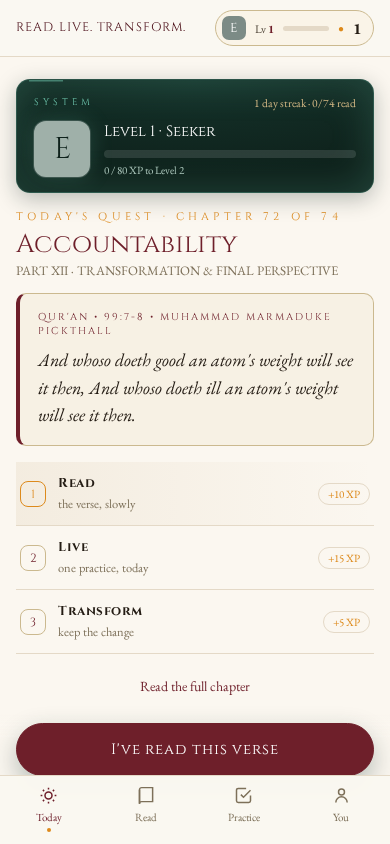
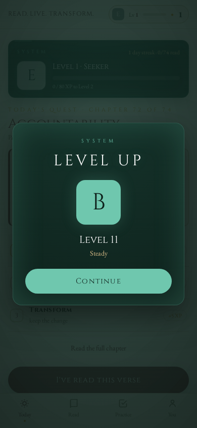
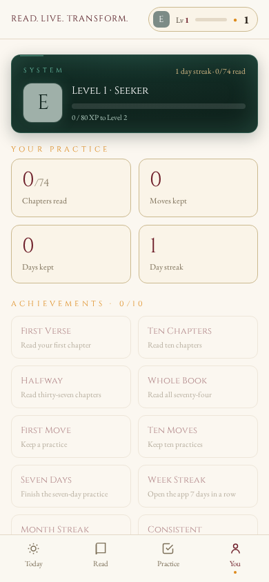

<div align="center">

# Read. Live. Transform.

**A practical reading of the Qur'an — as an app.**

*Read the verse. Live the practice. Keep the change.*

[](https://drsamonline.github.io/read-live-transform-app/)
[](https://drsamonline.github.io/read-live-transform-app/play/)
[](https://drsamonline.github.io/read-live-transform-app/play/)
[](https://drsamonline.github.io/read-live-transform-app/play/)
[](#)
[](LICENSE)

**[Landing page](https://drsamonline.github.io/read-live-transform-app/)** &nbsp;·&nbsp; **[Open the live app](https://drsamonline.github.io/read-live-transform-app/play/)** &nbsp;·&nbsp; **[Source](https://github.com/drsamonline/read-live-transform-app)**

</div>

---

<div align="center">


**A practical reading of the Qur'an — as an app.**

*Read the verse. Live the practice. Keep the change.*

<br>

[](LICENSE)
[](LICENSE)
[](https://drsamonline.github.io/read-live-transform-app/play/)
[](https://drsamonline.github.io/read-live-transform-app/play/)
[](#)

[](#)
[](#)
[](#)
[](https://github.com/drsamonline)

<br>


&nbsp;

&nbsp;


</div>

---

## What this is

The companion app to the book ***Read. Live. Transform.: A Practical Reading of
the Qur'an*** by **Dr Sohil Momin**. It carries all seventy-four chapters inside
it and turns the book's own method into something you do, not just read:

> **Read** the verse · **Live** the practice · **Transform** by keeping it.

One chapter is served each day, so the book unfolds over seventy-four days. Each
day is a small **quest** of three steps, and every step you complete earns XP
towards a level and a rank. The whole thing works **offline**, stores nothing on
any server, and is a single self-contained HTML file.

## Features

| | |
|---|---|
| **Today** | One chapter a day, by date. The verse, then the day's quest — Read, Live, Transform — with a single button that moves you to the next step. |
| **Read** | The whole book: the front matter, the twelve parts, and all seventy-four chapters, each with its verse card, explanation, practice, questions and takeaway. Write your answers; they save. |
| **Practice** | The book's seven-day practice as a checklist, plus **My moves** — every practice you keep, with a daily tap and a count. |
| **You** | Your level and rank, your stats, ten achievements, and the book's back matter. Export your practice, or reset your data. |
| **Progression** | Ranks **E → D → C → B → A → S** with titles, an XP bar, a day streak, and a **level-up** panel when you cross a threshold. |

XP is earned by doing: **+10** to read a chapter, **+15** to keep a practice,
**+5** to mark it done on a day, **+10** per day of the seven-day practice
(**+60** to finish it), and **+25** to complete a day's quest.

Full detail in **[docs/FEATURES.md](docs/FEATURES.md)**.

## Install

**Try it instantly** — open `index.html` in any browser. It runs offline, with no
build step and no dependencies.

**Install it as an app** — a PWA installs to the home screen when served over
`http://localhost` or `https://`:

```bash
# from the repository root
python3 -m http.server 8080
# then open http://localhost:8080
```

- **Android / Chrome:** menu (⋮) → *Install app*
- **iPhone / Safari:** Share → *Add to Home Screen*
- **Desktop Chrome / Edge:** the install icon in the address bar

A live copy is published with GitHub Pages:
**https://drsamonline.github.io/read-live-transform-app/play/**

More in **[docs/INSTALL.md](docs/INSTALL.md)**.

## The book

> *Read. Live. Transform.: A Practical Reading of the Qur'an*
> by **Dr Sohil Momin**

Seventy-four short chapters, each beginning with a verse of the Qur'an in the
Pickthall translation and ending with one thing to try. Verse, explanation,
application and practice are kept visibly separate, so the reader can always see
the difference between what the text says and how it might be lived.

- **Translation:** Muhammad Marmaduke Pickthall, *The Meaning of the Glorious
  Koran* (1930) — public domain.
- Every verse and reference in the app was checked against the authentic
  Pickthall text.

## Licence — please read

**This work is copyright © 2026 Dr Sohil Momin. All rights reserved.**

The source is published so the app can be **read, reviewed and used personally**.
It is **not** open source. You may **not** copy, modify, redistribute, host or
reuse it, in whole or in part, without the author's **prior written permission**.

Any use the author does permit must **credit the author and the book**:

> Based on *Read. Live. Transform.: A Practical Reading of the Qur'an* by
> Dr Sohil Momin.

To ask for permission, write to **sohilmomin2000@gmail.com**. The full terms are
in **[LICENSE](LICENSE)**; attribution details are in **[NOTICE.md](NOTICE.md)**.

## Privacy

Everything you do — reading, moves, notes, streak, XP — is stored **only in your
own browser**, on your own device. There is no account, no analytics, no network
call, and no server. Clearing your browser data (or *Reset my data*) removes it
all. See **[docs/PRIVACY.md](docs/PRIVACY.md)**.

## Tech

- **One file, no build.** The whole app — book text, interface, logic and fonts —
  is `index.html`, about **292 KB**, with no frameworks and no dependencies.
- **Offline-first PWA.** A service worker caches the app; fonts are embedded and
  subset to the glyphs actually used.
- **Plain JavaScript.** No bundler, no transpiler, no package manager.

See **[docs/ARCHITECTURE.md](docs/ARCHITECTURE.md)** and the code audit in
**[docs/AUDIT.md](docs/AUDIT.md)**.

```
.
├── index.html              the entire app
├── manifest.webmanifest    PWA manifest
├── sw.js                   service worker (offline cache)
├── icon-192.png            app icons
├── icon-512.png
├── screenshots/            images used above
├── docs/                   documentation
├── LICENSE                 proprietary — permission required
├── NOTICE.md               attribution
└── CONTRIBUTING.md         how to request permission
```

---

<div align="center">

**Read. Live. Transform.** — *The page ends at the book. The practice begins in life.*

Copyright © 2026 Dr Sohil Momin. All rights reserved.

</div>
